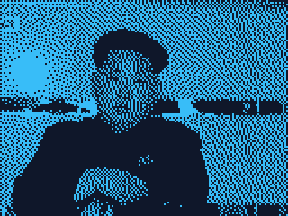

# DotXLSX

이미지 및 GIF 파일을 엑셀 픽셀아트(`.xlsx` / `.xlsm`)로 변환하는 Windows 데스크톱 애플리케이션입니다.

## 변환 예제 (Example)

| 원본 이미지 | 컬러 셀 (`80×60` 셀) | 점자 도트 (`80×30` 셀 / `160×120` 도트) |
| :---: | :---: | :---: |
|  |  |  |
| — | [sample_color_cell.xlsx](examples/sample_color_cell.xlsx) | [sample_braille.xlsx](examples/sample_braille.xlsx) |

> **Tip:** 생성된 엑셀 파일은 열자마자 전체 그림이 한눈에 보이도록 화면 배율(`zoomScale`)이 자동으로 맞춰집니다.

## 주요 기능

- **3가지 렌더링 모드**
  - **컬러 셀 (풀컬러 / GIF 32색):** 정적 이미지는 24-bit RGB 셀 배경색(`.xlsx`), GIF는 최대 32색 적응형 팔레트 + 조건부 서식 자동 재생(`.xlsm`)
  - **컬러 점자 (정적 고해상도):** 유니코드 점자(`U+2800`~`U+28FF`, 2×4 서브픽셀) + 64색 양자화 RGB 글자색(`.xlsx`)
  - **단색 점자 (고속 / GIF 최적):** 단일 스타일 점자 서브픽셀 렌더링 (저사양 PC 최적화)
- **클립보드 바로 붙여넣기 (`Ctrl+V`):** 스크린샷(`Win+Shift+S`)이나 복사한 이미지를 앱에서 `Ctrl+V`로 즉시 불러오기
- **디테일 보정 & 디더링:** 자동 대비(Auto-Contrast), 대비, 선명도, Floyd-Steinberg / Threshold, 색상 반전
- **GIF 자동 재생 `.xlsm` 내장 생성:** 순수 파이썬 MS-OVBA `vbaProject.bin` 빌더([vba_builder.py](dotxlsx/vba_builder.py))로 별도 템플릿 없이 자동 재생 `.xlsm` 생성 (정적 이미지는 매크로 없는 `.xlsx`로 저장)
- **실시간 미리보기:** 해상도/보정/테마 변경 시 즉시 프리뷰 반영 및 GIF 재생 컨트롤

## 실행 및 테스트

```powershell
# 앱 실행
python main.py

# 테스트 실행
python -m pytest -v

# 단일 실행 파일(.exe) 빌드
python -m PyInstaller --onefile --windowed --name DotXLSX --clean --noconfirm main.py
```
